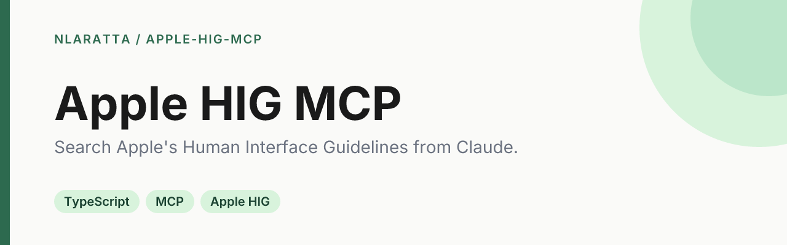

<p align="center">
  
</p>

<p align="center">
  <a href="https://github.com/nlaratta/apple-hig-mcp/actions/workflows/ci.yml"></a>
  <a href="LICENSE"></a>
</p>

An MCP server that lets Claude search and read Apple's [Human Interface Guidelines](https://developer.apple.com/design/human-interface-guidelines/) while you design or build for Apple platforms. It fetches the live pages at runtime, so answers track the current guidelines.

Unofficial: not affiliated with or endorsed by Apple. The guidelines are Apple's content and are never bundled in this repository; see [Content and copyright](#content-and-copyright).

## Quick start

Requires Node.js 20 or newer.

```bash
git clone https://github.com/nlaratta/apple-hig-mcp.git
cd apple-hig-mcp
npm install
npm run build
```

**Claude Code**

```bash
claude mcp add apple-hig -- node "$(pwd)/dist/index.js"
```

**Claude Desktop**: add this to `claude_desktop_config.json` (macOS: `~/Library/Application Support/Claude/claude_desktop_config.json`, Windows: `%APPDATA%\Claude\claude_desktop_config.json`), using the absolute path to your clone, then restart Claude Desktop:

```json
{
  "mcpServers": {
    "apple-hig": {
      "command": "node",
      "args": ["/absolute/path/to/apple-hig-mcp/dist/index.js"]
    }
  }
}
```

Then ask things like "What do the HIG say about button hit regions?" or "Compare the guidance for sheets and popovers".

## Tools

| Tool | What it does |
| --- | --- |
| `searchHIG` | Ranked search over page titles, names and summaries. Optional `platform` (`ios`, `ipados`, `macos`, `watchos`, `tvos`, `visionos`), `category` (`foundations`, `components`, `patterns`, `inputs`, `technologies`, `getting-started`) and `limit`. |
| `getGuideline` | Returns a full page as Markdown. Accepts a page id (`buttons`), a path (`components/buttons`) or a HIG URL. `includeExamples` toggles text descriptions of the page's images and videos. |
| `browseSection` | Lists the table of contents: the top level, or the pages inside a section such as `components` or `menus-and-actions`. Optional `platform` filter. |
| `getServerInfo` | Version, cache location and catalog status. |

Search covers page titles, names and summaries, not full body text. Use `getGuideline` to read a page.

## How it works

Apple's HIG site is a JavaScript app, but each page is backed by a JSON document at `https://developer.apple.com/tutorials/data/design/human-interface-guidelines/<page>.json`, the same data the site renders. The server fetches that JSON directly (no browser needed), converts it to Markdown, and builds a table of contents by walking the section pages (about 20 requests, once per cache lifetime).

- **Polite by default:** a descriptive `User-Agent`, one request at a time with a minimum delay between requests, retry with backoff, and a 24-hour cache in memory and on disk.
- **Cache location:** `~/.cache/apple-hig-mcp` (or `$XDG_CACHE_HOME/apple-hig-mcp`), outside the repository. Delete it any time.
- **Offline fallback:** if Apple is unreachable, a stale cached copy is served when one exists.

Environment variables (all optional):

| Variable | Default | Meaning |
| --- | --- | --- |
| `CACHE_ENABLED` | `true` | Set `false` to disable the disk cache |
| `CACHE_TTL` | `86400000` | Cache lifetime in milliseconds |
| `HIG_CACHE_DIR` | `~/.cache/apple-hig-mcp` | Where cached responses are stored |
| `DEBUG` | `false` | Verbose logging to stderr |

## Development

```bash
npm run dev      # run from source with tsx
npm test         # fast unit tests (vitest), no network
npm run smoke    # build, then call every tool over stdio against the live site (needs network)
```

## Project structure

```
src/
  index.ts          entry point (stdio)
  server.ts         MCP tool definitions and request handling
  hig/
    client.ts       fetch + rate limiting + cache for Apple's JSON
    catalog.ts      table of contents built from section pages
    search.ts       ranking (lexical tiers, then fuzzy via Fuse.js)
    render.ts       Apple's JSON content to Markdown
    service.ts      the logic behind each tool
tests/              unit tests with small hand-written fixtures
scripts/smoke.mjs   end-to-end check over stdio
docs/ARCHITECTURE.md
```

## Content and copyright

All guideline text and imagery belong to Apple Inc. This project does not include or redistribute any of it: pages are fetched from Apple's servers when you use a tool, cached locally on your machine, and returned with a link to the original page. Please follow [Apple's terms of use](https://www.apple.com/legal/internet-services/terms/site.html) and keep request volume reasonable. The tests use tiny synthetic fixtures, not copies of Apple's pages. "Apple" and related marks are trademarks of Apple Inc.

## License

[MIT](LICENSE) © Noah Laratta
