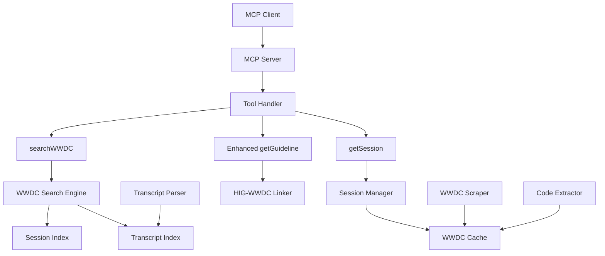

# WWDC Integration Technical Design Document

## Overview
Technical specifications for implementing WWDC session integration into the Apple HIG MCP Server.

## System Architecture



## Detailed Component Design

### 1. WWDC Scraper Module

```typescript
// src/wwdc/WWDCScraper.ts
import { Page } from 'playwright';
import { RateLimiter } from '../scraper/RateLimiter.js';
import { logger } from '../utils/logger.js';

export class WWDCScraper {
  private rateLimiter: RateLimiter;
  private baseUrl = 'https://developer.apple.com';
  
  constructor() {
    this.rateLimiter = new RateLimiter({
      maxRequests: 5,  // More conservative for WWDC
      windowMs: 60000
    });
  }

  async scrapeSessionList(year: number): Promise<WWDCSession[]> {
    const url = `${this.baseUrl}/videos/wwdc${year}`;
    await this.rateLimiter.acquire();
    
    // Implementation details...
  }

  async scrapeTranscript(sessionId: string): Promise<string> {
    // VTT files are typically at:
    // https://devstreaming-cdn.apple.com/videos/wwdc/{year}/{id}/subtitles/eng/{id}.vtt
    const vttUrl = this.constructVTTUrl(sessionId);
    return await this.downloadVTT(vttUrl);
  }

  private constructVTTUrl(sessionId: string): string {
    const year = sessionId.match(/wwdc(\d{4})/)?.[1];
    const id = sessionId.split('-')[1];
    return `https://devstreaming-cdn.apple.com/videos/wwdc/${year}/${id}/subtitles/eng/${id}.vtt`;
  }
}
```

### 2. Transcript Parser

```typescript
// src/wwdc/TranscriptParser.ts
export class TranscriptParser {
  /**
   * Parse WebVTT format into structured segments
   */
  parseVTT(vttContent: string): TranscriptSegment[] {
    const segments: TranscriptSegment[] = [];
    const lines = vttContent.split('\n');
    
    let currentSegment: Partial<TranscriptSegment> = {};
    let isInCue = false;
    
    for (const line of lines) {
      if (line.includes('-->')) {
        // Timestamp line: 00:00:12.500 --> 00:00:15.000
        const [start, end] = line.split('-->').map(t => this.parseTimestamp(t.trim()));
        currentSegment.startTime = start;
        currentSegment.endTime = end;
        isInCue = true;
      } else if (isInCue && line.trim() === '') {
        // End of cue
        if (currentSegment.text) {
          segments.push(currentSegment as TranscriptSegment);
        }
        currentSegment = {};
        isInCue = false;
      } else if (isInCue && line.trim()) {
        // Cue text
        currentSegment.text = (currentSegment.text || '') + line + ' ';
      }
    }
    
    return segments;
  }

  /**
   * Extract code-related segments using NLP patterns
   */
  findCodeSegments(segments: TranscriptSegment[]): TranscriptSegment[] {
    const codeIndicators = [
      /let\s+\w+\s*=/,
      /var\s+\w+\s*=/,
      /func\s+\w+/,
      /class\s+\w+/,
      /struct\s+\w+/,
      /import\s+\w+/,
      /@\w+/,  // Swift attributes
      /\w+\(\)/,  // Function calls
    ];
    
    return segments.filter(segment => 
      codeIndicators.some(pattern => pattern.test(segment.text))
    );
  }

  private parseTimestamp(timestamp: string): number {
    const parts = timestamp.split(':');
    const hours = parseInt(parts[0]) || 0;
    const minutes = parseInt(parts[1]) || 0;
    const seconds = parseFloat(parts[2]) || 0;
    return hours * 3600 + minutes * 60 + seconds;
  }
}
```

### 3. Session Indexer

```typescript
// src/wwdc/SessionIndexer.ts
import Fuse from 'fuse.js';
import { WWDCSession, WWDCTranscript } from '../types/wwdc.js';

export class SessionIndexer {
  private sessionIndex: Fuse<WWDCSession>;
  private transcriptIndex: Map<string, Fuse<TranscriptSegment>>;
  
  constructor() {
    this.sessionIndex = new Fuse([], {
      keys: [
        { name: 'title', weight: 0.4 },
        { name: 'description', weight: 0.3 },
        { name: 'topics', weight: 0.2 },
        { name: 'speakers', weight: 0.1 }
      ],
      threshold: 0.4,
      includeScore: true
    });
    
    this.transcriptIndex = new Map();
  }

  async indexSession(session: WWDCSession): Promise<void> {
    this.sessionIndex.add(session);
  }

  async indexTranscript(sessionId: string, transcript: WWDCTranscript): Promise<void> {
    const segmentIndex = new Fuse(transcript.segments, {
      keys: ['text'],
      threshold: 0.3,
      includeScore: true,
      ignoreLocation: true
    });
    
    this.transcriptIndex.set(sessionId, segmentIndex);
  }

  searchSessions(query: string, filters?: SearchFilters): SearchResult[] {
    let results = this.sessionIndex.search(query);
    
    if (filters?.year) {
      results = results.filter(r => r.item.year === filters.year);
    }
    
    if (filters?.platform) {
      results = results.filter(r => 
        r.item.platforms.includes(filters.platform!)
      );
    }
    
    return results.map(r => ({
      session: r.item,
      score: r.score || 0,
      highlights: this.extractHighlights(r.item, query)
    }));
  }

  searchTranscripts(query: string): TranscriptSearchResult[] {
    const results: TranscriptSearchResult[] = [];
    
    for (const [sessionId, index] of this.transcriptIndex) {
      const matches = index.search(query);
      if (matches.length > 0) {
        results.push({
          sessionId,
          matches: matches.map(m => ({
            segment: m.item,
            score: m.score || 0
          }))
        });
      }
    }
    
    return results;
  }
}
```

### 4. HIG-WWDC Integration

```typescript
// src/integration/HIGWWDCLinker.ts
import { Guideline } from '../types/index.js';
import { WWDCSession } from '../types/wwdc.js';

export class HIGWWDCLinker {
  private mappingCache: Map<string, HIGSessionMapping>;
  
  constructor() {
    this.mappingCache = new Map();
  }

  /**
   * Calculate relevance between a guideline and a WWDC session
   */
  calculateRelevance(guideline: Guideline, session: WWDCSession): number {
    let score = 0;
    
    // Platform matching (0.3 weight)
    if (guideline.platform && session.platforms.includes(guideline.platform)) {
      score += 0.3;
    }
    
    // Topic matching (0.4 weight)
    const commonTopics = this.findCommonTopics(guideline, session);
    score += (commonTopics.length / Math.max(guideline.topics?.length || 1, 1)) * 0.4;
    
    // Title/content similarity (0.3 weight)
    const textSimilarity = this.calculateTextSimilarity(
      guideline.title + ' ' + guideline.content,
      session.title + ' ' + session.description
    );
    score += textSimilarity * 0.3;
    
    return Math.min(score, 1.0);
  }

  /**
   * Find WWDC sessions related to a guideline
   */
  async findRelatedSessions(guidelineId: string, limit = 5): Promise<RelatedSession[]> {
    const cached = this.mappingCache.get(guidelineId);
    if (cached) {
      return cached.sessions.slice(0, limit);
    }
    
    const guideline = await this.getGuideline(guidelineId);
    const allSessions = await this.getAllSessions();
    
    const scored = allSessions.map(session => ({
      session,
      relevance: this.calculateRelevance(guideline, session)
    }));
    
    const related = scored
      .filter(s => s.relevance > 0.3)  // Minimum threshold
      .sort((a, b) => b.relevance - a.relevance)
      .slice(0, limit);
    
    this.mappingCache.set(guidelineId, {
      guidelineId,
      sessions: related,
      lastUpdated: new Date()
    });
    
    return related;
  }

  private calculateTextSimilarity(text1: string, text2: string): number {
    // Simple Jaccard similarity
    const words1 = new Set(text1.toLowerCase().split(/\s+/));
    const words2 = new Set(text2.toLowerCase().split(/\s+/));
    
    const intersection = new Set([...words1].filter(w => words2.has(w)));
    const union = new Set([...words1, ...words2]);
    
    return intersection.size / union.size;
  }
}
```

### 5. Enhanced MCP Tools

```typescript
// src/tools/searchWWDC.ts
export const searchWWDCTool = {
  name: 'searchWWDC',
  description: 'Search WWDC session videos and transcripts',
  inputSchema: {
    type: 'object',
    properties: {
      query: {
        type: 'string',
        description: 'Search query'
      },
      year: {
        type: 'number',
        description: 'Filter by specific year (e.g., 2023)'
      },
      platform: {
        type: 'string',
        enum: ['ios', 'macos', 'watchos', 'tvos', 'visionos'],
        description: 'Filter by platform'
      },
      searchIn: {
        type: 'string',
        enum: ['all', 'titles', 'transcripts', 'code'],
        description: 'Where to search',
        default: 'all'
      },
      includeCode: {
        type: 'boolean',
        description: 'Include code examples in results',
        default: true
      }
    },
    required: ['query']
  },
  
  async execute(params: SearchWWDCParams): Promise<ToolResponse> {
    const { query, year, platform, searchIn, includeCode } = params;
    
    // Search implementation
    const results = await wwdcSearchEngine.search({
      query,
      filters: { year, platform },
      searchIn: searchIn || 'all',
      includeCode: includeCode ?? true
    });
    
    return formatWWDCSearchResults(results);
  }
};
```

### 6. Data Persistence

```typescript
// src/cache/WWDCCacheManager.ts
export class WWDCCacheManager extends CacheManager {
  private sessionCache: NodeCache;
  private transcriptCache: NodeCache;
  
  constructor(config: CacheConfig) {
    super(config);
    
    this.sessionCache = new NodeCache({
      stdTTL: 604800,  // 1 week for session metadata
      checkperiod: 3600
    });
    
    this.transcriptCache = new NodeCache({
      stdTTL: 2592000,  // 30 days for transcripts
      checkperiod: 86400
    });
  }

  async storeSession(session: WWDCSession): Promise<void> {
    this.sessionCache.set(session.id, session);
    await this.persistToDisk('sessions', session.id, session);
  }

  async storeTranscript(transcript: WWDCTranscript): Promise<void> {
    this.transcriptCache.set(transcript.sessionId, transcript);
    await this.persistToDisk('transcripts', transcript.sessionId, transcript);
  }

  async getSessionsByYear(year: number): Promise<WWDCSession[]> {
    const allKeys = this.sessionCache.keys();
    const sessions: WWDCSession[] = [];
    
    for (const key of allKeys) {
      const session = this.sessionCache.get<WWDCSession>(key);
      if (session?.year === year) {
        sessions.push(session);
      }
    }
    
    return sessions;
  }
}
```

## API Response Formats

### searchWWDC Response
```json
{
  "content": [
    {
      "type": "text",
      "text": "Found 3 WWDC sessions matching 'SwiftUI navigation':\n\n..."
    }
  ],
  "metadata": {
    "totalResults": 3,
    "searchTime": 245,
    "filters": {
      "year": 2023,
      "platform": "ios"
    }
  }
}
```

### getSession Response
```json
{
  "content": [
    {
      "type": "text",
      "text": "**Session Title** (WWDC23-10052)\n\n..."
    }
  ],
  "metadata": {
    "session": {
      "id": "wwdc2023-10052",
      "duration": 1380,
      "hasTranscript": true,
      "hasCode": true,
      "relatedGuidelines": ["navigation-ios", "tab-bars"]
    }
  }
}
```

## Performance Considerations

1. **Indexing Strategy**
   - Index sessions incrementally as they're accessed
   - Pre-index popular sessions
   - Use background workers for transcript processing

2. **Search Optimization**
   - Implement search result caching
   - Use pagination for large result sets
   - Optimize Fuse.js settings for performance

3. **Memory Management**
   - Limit in-memory transcript storage
   - Implement LRU eviction for caches
   - Stream large transcript files

## Testing Strategy

### Unit Tests
```typescript
// tests/wwdc/TranscriptParser.test.ts
describe('TranscriptParser', () => {
  it('should parse VTT format correctly', () => {
    const vtt = `WEBVTT

00:00:00.500 --> 00:00:02.000
Hello, welcome to WWDC

00:00:02.500 --> 00:00:05.000
Today we'll talk about SwiftUI`;
    
    const segments = parser.parseVTT(vtt);
    expect(segments).toHaveLength(2);
    expect(segments[0].startTime).toBe(0.5);
    expect(segments[0].text).toContain('Hello');
  });
});
```

### Integration Tests
```typescript
// tests/integration/HIG-WWDC.test.ts
describe('HIG-WWDC Integration', () => {
  it('should find related WWDC sessions for a guideline', async () => {
    const related = await linker.findRelatedSessions('navigation-ios');
    expect(related).toHaveLength(5);
    expect(related[0].relevance).toBeGreaterThan(0.5);
  });
});
```

## Deployment Checklist

- [ ] Update package.json with new dependencies
- [ ] Add WWDC-related environment variables
- [ ] Update CLAUDE.md with new architecture details
- [ ] Create migration scripts for existing cache
- [ ] Update MCP tool documentation
- [ ] Add WWDC examples to README.md
- [ ] Test with Claude Desktop
- [ ] Monitor performance metrics
- [ ] Set up error tracking for new components